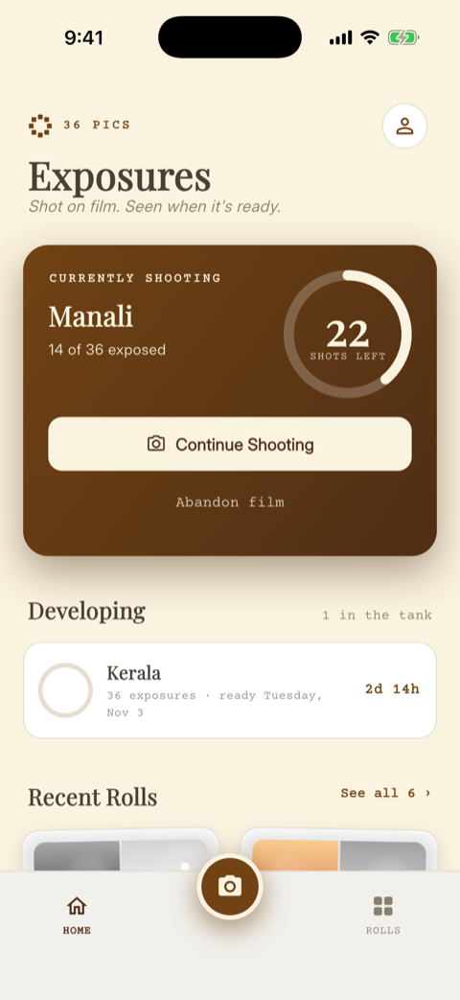
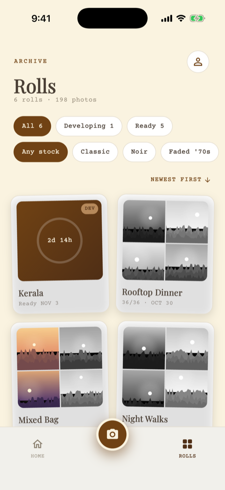
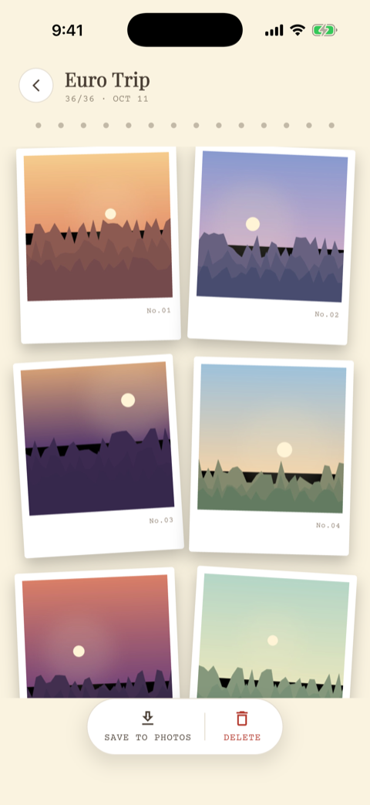
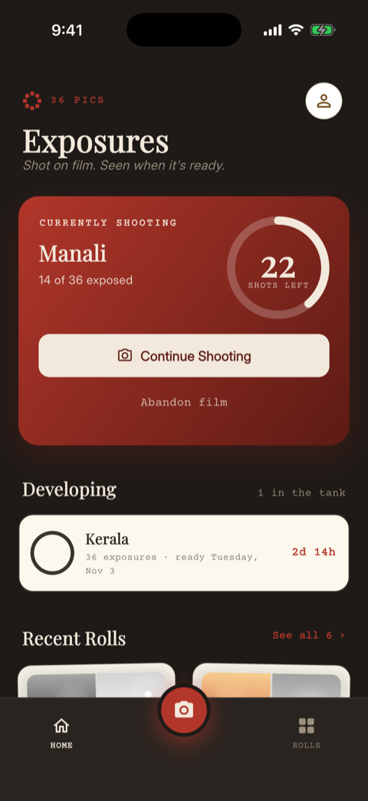
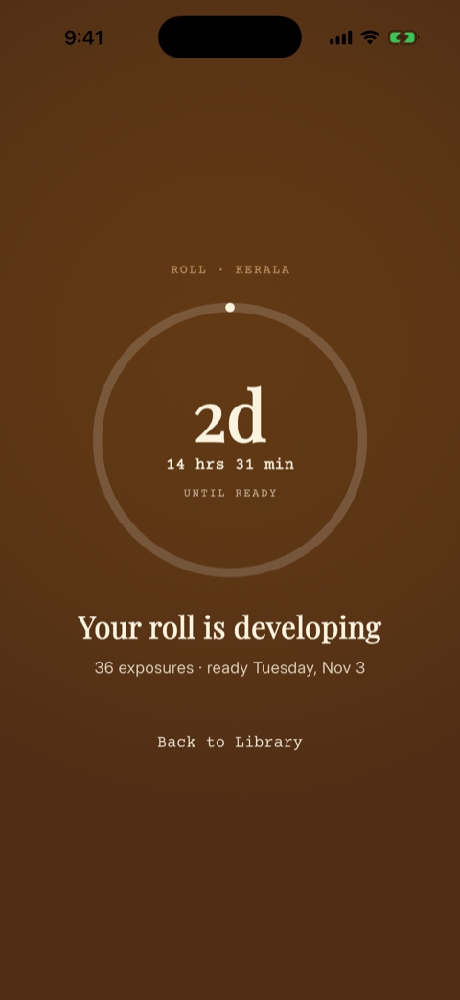
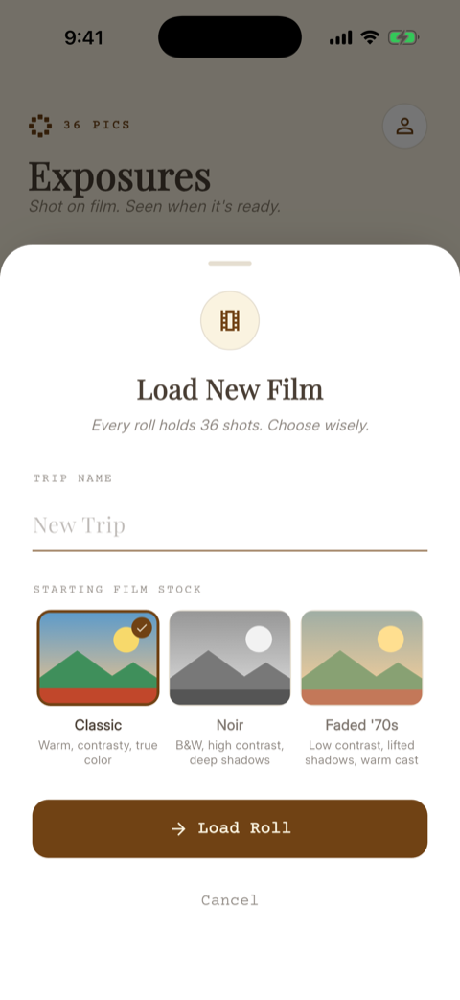
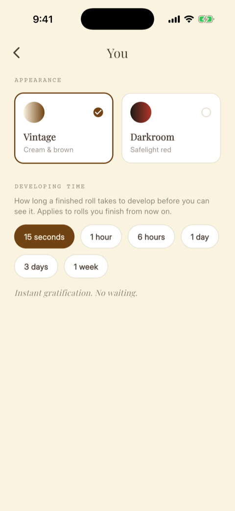
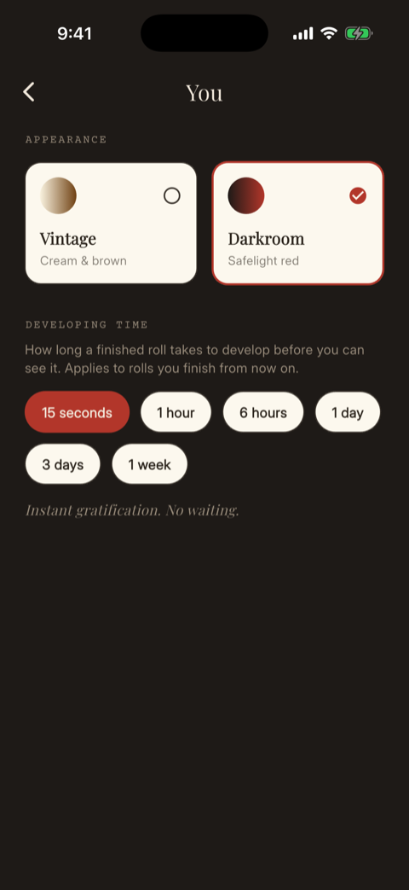

# 📸 36 Pics

A minimalist, disposable-film-camera app for Flutter. Every trip gets **one roll, 36 shots** — load it, shoot it, let it develop, then relive it. No infinite camera roll, no endless scrolling — just the deliberate pace of film.

<p align="center">
  
  
  
  
</p>

---

## 🎯 Concept

On vacations or weekend trips, we often get lost in taking *too many* pictures, losing the moment itself.
**36 Pics** reintroduces that nostalgic constraint — you get **only 36 shots** per trip, so every photo counts. Finish a roll and it has to *develop* before you can see it, just like real film.

> **Load → Shoot → Develop → Relive**

---

## ✨ Features

- 🎞 **One roll per trip** — load new film with a name and a film stock, shoot up to 36 exposures
- 📷 **Real camera** — live viewfinder with tap-to-focus, pinch zoom, flash and front/back flip
- 🎨 **Film stocks** — **Classic**, **Noir** (B&W) and **Faded '70s**, baked into every photo. Switch stock mid-roll; the roll is then labelled *MIXED*
- 🔢 **Frame-counter dial** — a circular ring tracks exposures left on the current roll
- 🧪 **Developing ritual** — a finished roll develops before you can see it. Choose the wait on the **You** screen: 15 seconds up to 1 week. The countdown keeps running while the app is closed
- ✂️ **Abandon film** — end a roll early and it develops with whatever you shot, in 5 seconds
- 🏠 **Home** — the roll in your camera, anything still developing, and your latest developed rolls
- 🗂 **Rolls archive** — every finished roll, filterable by status (All / Developing / Ready) and by film stock, sortable newest or oldest first
- 🖼 **Polaroid gallery** — developed rolls render as a grid of rotated polaroid prints
- 💾 **Save to Photos** — export a developed roll to your Photos library, as a new album or as plain photos. Photos stay private to the app until you do
- 🗑 **Delete a roll** — long-press any finished roll
- 🌗 **Two themes** — **Vintage** (cream & brown, like a classic photo album) and **Darkroom** (near-black with safelight red). Switch from the person button on Home or Rolls

---

## 📱 Screenshots

| Home | Rolls archive |
|---|---|
|  |  |

| Developing | Gallery |
|---|---|
|  |  |

| Load New Film | Home (Darkroom) |
|---|---|
|  |  |

| You (Vintage) | You (Darkroom) |
|---|---|
|  |  |

> Screenshots use generated sample photos, shot in the iOS Simulator.

---

## 🛠 Tech Stack

- [Flutter](https://flutter.dev/) (iOS-first; Android builds but is untested on a device)
- `camera` for the viewfinder and capture
- `image` to bake film-stock looks into each photo (on a background isolate)
- `path_provider` + a small JSON store for rolls and photos in the app's private storage
- `gallery_saver` to export developed rolls to the Photos library
- Custom `ThemeController` and `RollStore` (`ChangeNotifier` singletons) — no external state-management package

---

## 🚀 Getting Started

Clone the repo:

```bash
git clone https://github.com/CovertlyOvert/36-pics.git
cd 36-pics
flutter pub get
flutter run
```

Requires Flutter (stable channel) and, for iOS, Xcode + CocoaPods. The camera needs a real device; on a simulator you can browse rolls, themes and settings, but not shoot.

Run the tests with `flutter test`.
